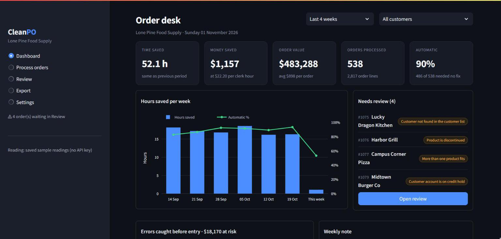
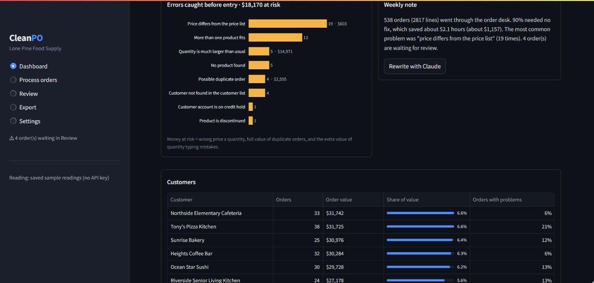
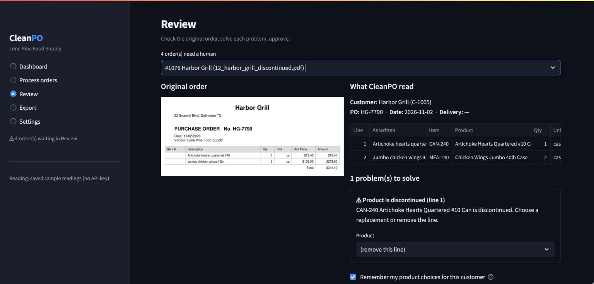

# CleanPO

Customer orders in, clean ERP import out.

CleanPO reads the purchase orders that a wholesale distributor receives (PDF, e-mail, Excel,
CSV, photo). It matches each line to the distributor's own product codes, customer accounts
and prices. It checks the order, and it makes one import file for the ERP. Orders with a
problem go to a review screen with the reason. A dashboard shows the time and money saved.

All data in this repository is synthetic. The distributor "Lone Pine Food Supply", its
customers, products and prices are made up.

## Screenshots

Dashboard: time and money saved, order value, orders that need a human.



Errors caught before entry, and the value of orders per customer.



Review: the original order next to what CleanPO read, with one fix for each problem.



## How an order moves

1. **Read.** The Claude API reads the file and returns the customer, the lines, the quantities
   and the prices in a fixed JSON structure.
2. **Match.** Python code finds the customer (sender e-mail, then name) and each product
   (exact code, the customer's own code, the memory list, then name similarity).
   When two products are possible, Claude can choose from the candidates, but only when the
   text or the order history makes the choice clear.
3. **Check.** Code (not AI) checks prices against the price list, finds duplicate orders,
   unusual quantities, discontinued items, unknown customers and accounts on credit hold.
   It also converts units, for example 60 cans to 10 cases.
4. **Sort.** Orders without a problem are ready. Orders with a problem wait for a human.
   E-mails that are not orders are kept out.
5. **Review.** The reviewer sees the original document next to the reading and solves each
   problem. The choices go into the memory list, so the same text matches next time.
6. **Export.** One CSV import file for all ready orders, and a summary workbook.

## Run the demo

```
pip install -r requirements.txt
python scripts/make_demo_data.py
streamlit run app.py
```

Then open "Process orders" and click "Load sample orders".

Without an API key the app runs in demo mode: it uses saved readings of the 16 sample orders
(`demo_data/readings`). To read new files, set the `ANTHROPIC_API_KEY` environment variable
before you start the app. Do not type the key into the app or into a file.

On the first start, the app adds six weeks of synthetic history, so that the dashboard shows
trends. A note under the dashboard shows while this history exists. "Settings > Remove sample
history" deletes it.

## Import a price list

A client sends the price list in the layout of their own system. CleanPO reads it into the
product list:

- **Excel or CSV.** Code finds the header row and the columns (for example "Item #",
  "Description", "Pack/Size", "U/M", "Case Price", "Status"). Title rows, section headings and
  "$" signs are permitted. No AI is used.
- **PDF or photo.** The Claude API reads the list into a fixed structure. This needs the API key.
- **Checks.** Rows without a code, without a price, or with a duplicate code are not loaded.
  Each one is shown with its row number. A list without item codes gets codes P-0001, P-0002...
- **Pack units.** CleanPO uses the inner unit ("6/#10", "8/LOAF") only when the list or the end
  of the product name gives it. It does not guess. Without an inner unit, an order for "60 cans"
  goes to review and is not converted.

In the app: "Settings > Import a price list". Look at the result, then click "Use this price list".

## Free test for a new client

```
python scripts/run_trial.py --orders <folder> --price-list <file> --out data/trials/<client>
                            [--customers <file>]
```

The command reads the price list, processes all order files in the folder, and writes to the
output folder: the products as read, the price-list problems, one import file for the ready
orders, a summary workbook and `report.md`. Senders that are not in the customer list are added
as new customers (NEW-001...). Copies of the files go to a temporary folder that is deleted at
the end. Delete the output folder after the test.

Sample price lists in four layouts are in `demo_data/price_lists/`
(`python scripts/make_price_lists.py`).

## Tests

```
python -m pytest -q
```

The tests process the 16 sample orders and compare each result with `demo_data/expected.json`:
8 ready orders, 7 orders with one planted problem each, and 1 e-mail that is not an order.
`tests/test_pricelist.py` reads the four sample price lists and compares each product with the
master list. It also runs a full free test. The Claude path for price lists is tested with a
fake API client.

## Time saved

Time saved = (handled orders x manual minutes per order) - real review time.
The default is 6 manual minutes per order. Replace it with the client's own value: the clerk
times 10 orders by hand during the trial. The hourly rate default is the May 2025 BLS median wage for order clerks
(USD 22.20). Both values are in Settings.

## Layout

```
app.py                     Streamlit app (dashboard, process, review, export, settings)
cleanpo/reader.py          Claude API reading, structured output, replay mode
cleanpo/matcher.py         customer and product matching
cleanpo/pipeline.py        checks, sorting, approve and reject
cleanpo/export.py          import CSV and summary workbook
cleanpo/metrics.py         dashboard numbers and synthetic demo history
cleanpo/pricelist.py       price-list and customer-list import, any layout
cleanpo/trial.py           free-test runner
cleanpo/db.py              DuckDB tables
scripts/make_demo_data.py  synthetic distributor, customers, products and 16 orders
scripts/make_price_lists.py  synthetic price lists in four layouts
scripts/run_trial.py       free test from the command line
demo_data/                 the generated demo data
docs/                      screenshots
```

## Status

- Tested in replay mode (49 tests pass).
- The Claude API reading paths (orders and price lists) are written to the current API
  documentation but have not yet run against the live API. Test them with an API key before
  a client demo.
- The import layout is a generic sales-order CSV. Change it to the client's ERP layout during setup.
